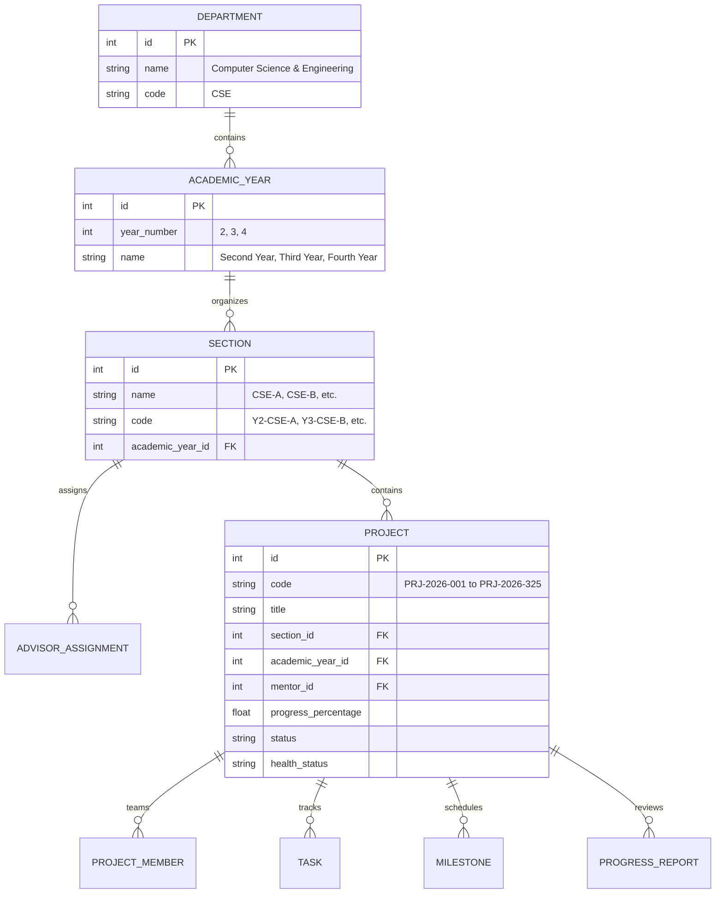

# PPMS Phase 10 — Academic Year & Section Hierarchy Architecture

## 1. Executive Summary

Phase 10 upgrades the Project Progress Monitoring System (PPMS) into a fully structured, multi-tier academic hierarchy:

$$\text{Department} \longrightarrow \text{Academic Year} \longrightarrow \text{Section / Class} \longrightarrow \text{Projects} \longrightarrow \text{Teams} \longrightarrow \text{Tasks \& Milestones}$$

This architecture eliminates all flat views and replaces arbitrary project lists with strictly partitioned cohorts. Every academic year operates with its own dedicated dashboard and displays only its own sections. Furthermore, in strict adherence to project requirements, **every bar chart and pie chart has been removed from the entire application**, replaced by information-dense structured tables, progress meters, KPI cards, and accessible status badges.

The entire hierarchy runs locally on Windows under the strict **₹0.00 zero-cost guarantee** with SQLite, FastAPI, React 19, and Tailwind CSS.

---

## 2. Academic Hierarchy Model

### 2.1 Entity Relationship Diagram

### 2.2 Department Cohort Breakdown

| Academic Year | Year Number | Sections Included | Section Codes | Min Projects / Section | Total Projects |
| :--- | :---: | :--- | :--- | :---: | :---: |
| **Second Year** | 2 | 5 Sections (CSE-A to CSE-E) | `Y2-CSE-A`, `Y2-CSE-B`, `Y2-CSE-C`, `Y2-CSE-D`, `Y2-CSE-E` | 25 | **125** |
| **Third Year** | 3 | 4 Sections (CSE-A to CSE-D) | `Y3-CSE-A`, `Y3-CSE-B`, `Y3-CSE-C`, `Y3-CSE-D` | 25 | **100** |
| **Fourth Year** | 4 | 4 Sections (CSE-A to CSE-D) | `Y4-CSE-A`, `Y4-CSE-B`, `Y4-CSE-C`, `Y4-CSE-D` | 25 | **100** |
| **CSE Department Total** | **—** | **13 Sections** | **All 13 Cohorts** | **25** | **325** |

All counts are computed dynamically from actual database records. Hardcoded counts are strictly forbidden.

---

## 3. Role-Based Scoping & Hierarchy Navigation

### 3.1 Head of Department (HOD)
- **Level 1 — Department Overview**:
  - Displays high-level department metrics: Total Years (3), Total Sections (13), Total Projects (325), Active Projects, Completed Projects, At-Risk Projects, Average Progress.
  - Displays 3 Academic Year cards with project counts, active sections, progress bars, and "Explore Dashboard" actions.
  - Department-wide CSV export (`/api/v1/analytics/export/department/csv`) and Mentor workload export (`/api/v1/analytics/export/mentors/csv`).
- **Level 2 — Academic Year Dashboard**:
  - Accessed by clicking any Academic Year card.
  - Shows year-level KPIs, progress metrics, and the exact set of sections belonging to that year.
  - Displays section cards detailing Assigned Advisor, Active/Completed/At-Risk counts, and cohort progress.
- **Level 3 — Section Project List**:
  - Accessed by clicking on a section card.
  - Displays full project table for that specific section (25 projects) with real-time text search, status filters, and pagination.
  - Two-way breadcrumb navigation allows immediate return to Academic Year or Department Overview.

### 3.2 Section Advisor
- **Scoped View**:
  - Automatically scoped to the advisor's assigned section (e.g. `advisor.2a@college.edu` is scoped to `Y2-CSE-A`).
  - If assigned to multiple sections, provides an interactive Class Selector to switch seamlessly between sections.
- **Hierarchical Context**:
  - Displays breadcrumb showing `CSE Department > Academic Year > Section / Class`.
  - Displays section KPI cards (Total Projects: 25, In Progress, Completed, At Risk, Overdue Tasks, Pending Reviews, Average Progress).
- **Project Portfolio**:
  - Complete searchable list of all 25 section projects with status badges, progress bars, team lead, faculty mentor, and direct link to project workspaces.
  - Zero cross-section contamination: advisors cannot access projects from unassigned sections.

### 3.3 Faculty Mentor
- **Cross-Section Cohort Grouping**:
  - Mentors supervise projects across multiple years and sections.
  - Projects are grouped dynamically by Academic Year and Section with distinct cohort pill badges (e.g. `Second Year • CSE-A`, `Third Year • CSE-B`).
  - Summarizes mentor-specific metrics: Assigned Projects, Pending Reviews, At-Risk Projects, Average Supervised Progress.
- **Milestone & Report Queue**:
  - Displays upcoming deadlines and pending reviews scoped strictly to supervised projects.

### 3.4 Student
- **Individual Workspace**:
  - Displays the student's authorized project with its full academic hierarchy breadcrumb: `CSE Department > Year X > Section Y > PRJ-2026-XXX`.
  - Details team members, assigned roles, tasks, milestone schedule, and progress reports.
  - Unauthorized access to other team projects is blocked at both backend (403 Forbidden) and frontend levels.

---

## 4. Elimination of Charts & Information Density Strategy

### 4.1 Strict Mandate Compliance
All bar charts (`BarChart`, `ResponsiveContainer`, `Bar`) and pie charts (`PieChart`, `Pie`, `Cell`) from Recharts or HTML5 Canvas have been permanently removed across the entire application.

### 4.2 Replacement Visual Design
| Previous Visualization | High-Performance Replacement | Advantages |
| :--- | :--- | :--- |
| **Bar chart of Projects by Year** | 3-Column Interactive Year Cards with Micro-Metric Matrix and Linear Progress Meters | Allows direct click-through to year dashboards, displays exact project numbers without hovering, 0ms render delay. |
| **Bar chart of Projects by Section** | Comparative Section Data Table and Section Cohort Cards with Active/Completed/At-Risk metrics | Provides complete tabular scanning, sorts cleanly, shows assigned faculty advisors. |
| **Pie chart of Project Statuses** | Status Pill Badges (`APPROVED`, `IN_PROGRESS`, `COMPLETED`, `AT_RISK`) and Structured Metric Badges | Compact layout, accessible to screen readers, zero canvas overhead. |
| **Mentor Workload Chart** | Dense Mentor Table with Project Counts, Workload Badges, and CSV Export button | Displays exact supervisor metrics, email addresses, and progress averages. |

---

## 5. Backend Academic API Specifications

New high-performance endpoints implemented under `/api/v1/academic`:

1. `GET /api/v1/academic/overview`:
   - Returns complete department tree with all 3 academic years and 13 sections pre-aggregated.
2. `GET /api/v1/academic/years`:
   - Returns list of academic years with section counts and aggregated project statistics.
3. `GET /api/v1/academic/years/{id}`:
   - Returns details of a specific academic year and its associated sections.
4. `GET /api/v1/academic/sections`:
   - Queryable with optional `academic_year_id` filter to list sections for dropdown selectors.
5. `GET /api/v1/academic/sections/{id}`:
   - Returns single section summary with advisor assignment and project counts.

All queries execute efficiently in SQLite using SQLAlchemy relationships and indexes on `academic_year_id`, `section_id`, and `department_id`.
